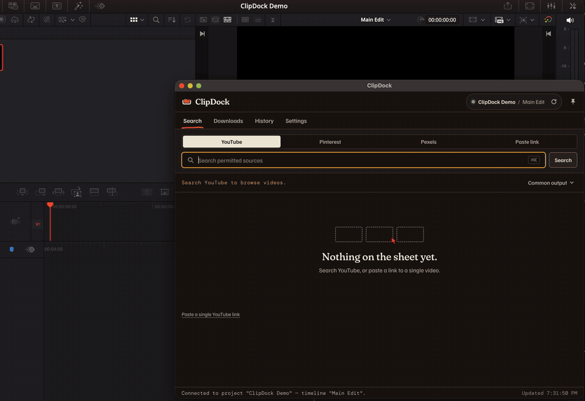
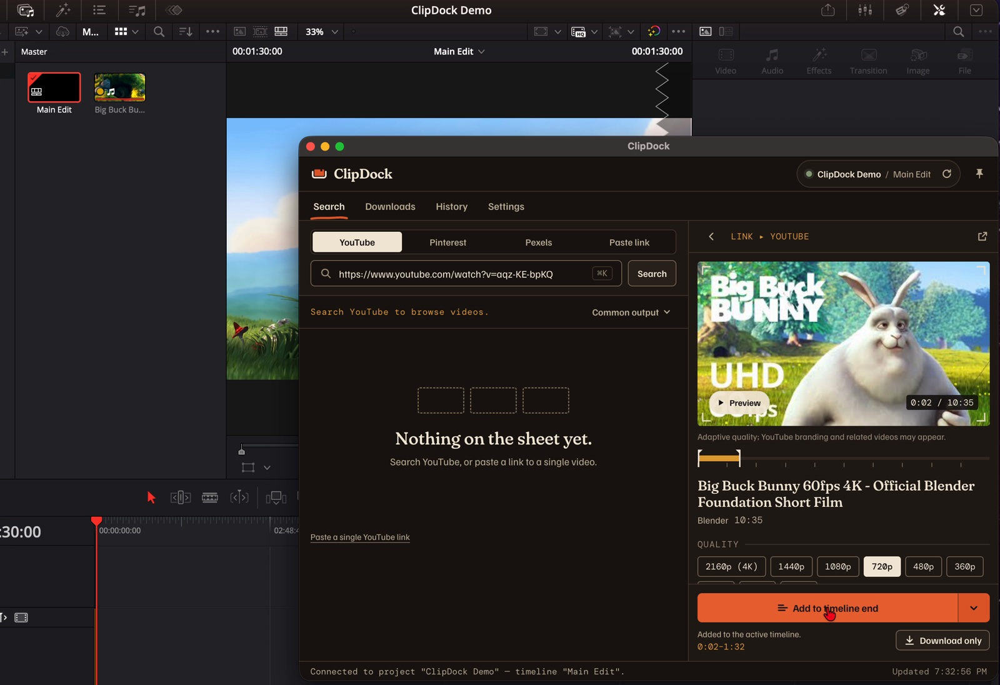

# ClipDock

Find, download and drop media into DaVinci Resolve Studio without leaving Resolve.




## What it does

- Find media through YouTube, Pinterest and Pexels search, or paste a supported link.
- Download a whole YouTube video or pick an In/Out range before downloading.
- Choose video quality, or download YouTube audio only and optional SRT subtitles
  when available. Keep the original video or prepare a Fast or Edit-ready version.
- Send files to the Media Pool, the playhead or the timeline end. Choose the active
  bin or a ClipDock bin, or use **Download only** to save without importing.
- Drag downloaded files from the panel into Resolve.
- Find earlier downloads in **History** and reuse files that are still available.

## Sources

| Source | What you get | Needs |
|---|---|---|
| YouTube | Search and single-video links; full clips, ranges, audio and subtitles | yt-dlp, ffmpeg, ffprobe and a supported JavaScript runtime |
| Pexels | Search stock photos and videos | A free [Pexels API key](https://www.pexels.com/api/); saved in macOS Keychain |
| Pinterest | Search or public Pin links; images, videos and carousel items | gallery-dl 1.28+; videos also need the yt-dlp Python module and ffmpeg |
| Instagram / X / Facebook | Public video links | yt-dlp, ffmpeg and ffprobe |

Pinterest boards, profiles and private Pins are not supported.
Social sources accept links; they do not have search in ClipDock.

## Requirements

- **DaVinci Resolve Studio.** Workflow Integrations do not run in the free edition.
  Tested on macOS with Resolve Studio 21. Windows support is built in but untested.
- **Node.js 18+** to build and install the plugin.
- **Deno 2.3+ or Node.js 22+** for yt-dlp's YouTube challenge solving.
  ClipDock skips older versions of these runtimes.
- **yt-dlp, ffmpeg and ffprobe** for YouTube and social downloads and media preparation.
  **gallery-dl 1.28+** is needed for Pinterest. These tools are not bundled.

On macOS, install the tools with Homebrew. The ffmpeg package includes ffprobe:

```sh
brew install yt-dlp ffmpeg gallery-dl deno
```

ClipDock looks on `PATH` and in common install locations. See
[Settings and files](#settings-and-files) for executable overrides.

## Install

1. Clone the repository:

   ```sh
   git clone https://github.com/Srcanesen/ClipDock.git
   cd ClipDock
   ```

2. Install build dependencies:

   ```sh
   npm install
   ```

3. Build and copy ClipDock into Resolve's plugin folder:

   ```sh
   npm run install:plugin
   ```

> [!NOTE]
> On macOS, writing to Resolve's system plugin folder needs administrator rights.
> If installation is denied, build first, then run the installer with elevation:
>
> ```sh
> npm run build
> sudo node scripts/install-plugin.mjs
> ```

4. Verify the installed files against the completed build:

   ```sh
   npm run verify:installed
   ```

5. Restart Resolve completely so it discovers the installed panel.

| OS | Plugin folder |
|---|---|
| macOS | `/Library/Application Support/Blackmagic Design/DaVinci Resolve/Workflow Integration Plugins/com.clipdock.app/` |
| Windows | `%PROGRAMDATA%\Blackmagic Design\DaVinci Resolve\Support\Workflow Integration Plugins\com.clipdock.app\` |

The installer copies `WorkflowIntegration.node` from your installed Resolve developer
examples (**Help › Documentation › Developer**). This native bridge belongs to Resolve
and is not included in this repository.

## Quick start

1. Open a project and timeline in Resolve Studio.
2. Open **Workspace › Workflow Integrations › ClipDock**.
3. Search a source or paste a supported public link, then select the media.
4. For YouTube, set an In/Out range if needed. Choose quality and a video profile
   where available; YouTube also offers audio-only downloads and subtitles.
5. Choose **Timeline end** in the action menu and click **Add to timeline end**.
   You can also choose **Add to Media Pool**, **At playhead** or **Download only**.

Completed files appear in the panel and can be reused from **History**.



## Troubleshooting

- **Panel missing from the menu or not connected** → Run `npm run verify:installed`,
  reinstall if it reports a mismatch or missing `WorkflowIntegration.node`, then
  restart Resolve completely.
- **Using the free edition** → ClipDock requires Resolve Studio for Workflow Integrations.
- **yt-dlp, ffmpeg or ffprobe not found** → Install the missing tool, make it available
  to Resolve on `PATH`, or set `CLIPDOCK_YTDLP_PATH`, `CLIPDOCK_FFMPEG_PATH` or
  `CLIPDOCK_FFPROBE_PATH` before starting Resolve. Reopen the panel after changes.
- **YouTube returns 403 or reports no JavaScript runtime** → Check that Deno 2.3+
  or Node.js 22+ is discoverable. Use `CLIPDOCK_DENO_PATH` for a specific Deno executable.
- **Pinterest reports gallery-dl missing** → Install gallery-dl 1.28+ or set
  `CLIPDOCK_GALLERYDL_PATH`. Only public Pins are supported.
- **Pexels search is disconnected** → Enter a valid Pexels API key in **Settings**.
  If secure storage fails, check the connection message before trying again.

## Settings and files

Downloads default to the operating system's Downloads folder under `ClipDock`
(`Downloads/ClipDock`). Change it in **Settings › Download folder › Change…**.
Choose an empty folder or one already managed by ClipDock. Changing the folder
leaves existing files in place; it does not move or delete them.

**History** lists previous downloads, their availability and reuse actions.
Its metadata is stored in `download-history.json` under Electron's `userData`
directory, alongside `clipdock-settings.json`. Media stays in the download folder.
On macOS, the Pexels API key is stored in Keychain.

To select specific executables, set these variables to absolute executable paths
in the environment used to launch Resolve:

| Variable | Tool |
|---|---|
| `CLIPDOCK_YTDLP_PATH` | yt-dlp |
| `CLIPDOCK_FFMPEG_PATH` | ffmpeg |
| `CLIPDOCK_FFPROBE_PATH` | ffprobe |
| `CLIPDOCK_GALLERYDL_PATH` | gallery-dl |
| `CLIPDOCK_DENO_PATH` | Deno |

## How it works

ClipDock is an Electron-based Workflow Integration panel.
It runs system-installed yt-dlp, gallery-dl and ffmpeg as separate processes,
with ffprobe for media inspection; these tools are not bundled.
It talks to Resolve through the Workflow Integration scripting API and has no telemetry.

## Development

```sh
npm test                       # Build and run automated tests without Resolve.
npm run check                  # Build and verify the plugin.
npm run preview                # Serve the panel with sample data at /?preview=ready.
npm run test:resolve:headless  # Check the Resolve scripting API without a GUI.
npm run test:resolve:e2e       # Exercise transfer, status and media preparation in Resolve.
```

For preview, open the printed local URL with `/?preview=ready`; bare `/` has no host API.
The Resolve checks currently support macOS and need Resolve Studio installed and closed,
with no fuscript running. The E2E check creates and deletes its own throwaway
`ClipDock-E2E-` project. Run `npm run build` before it.
See [CONTRIBUTING.md](CONTRIBUTING.md) for setup and pull request guidance.

## Responsible use

Downloading may breach a source service's terms. You are responsible for the rights
to download and use media and for following applicable terms and laws.
ClipDock supports public content only and uses no logins, cookies or proxies.
Pinterest search uses its public web interface, not an official API.
Pexels media is subject to the [Pexels license](https://www.pexels.com/license/).

ClipDock is not affiliated with or endorsed by Blackmagic Design, Google/YouTube,
Meta, X, Pinterest, Pexels, yt-dlp or gallery-dl.

## License and credits

ClipDock is [MIT licensed](LICENSE). Third-party tools keep their own licenses.
Bundled fonts use the SIL Open Font License:
[Familjen Grotesk](static/fonts/OFL-FamiljenGrotesk.txt),
[Fraunces](static/fonts/OFL-Fraunces.txt) and [DM Mono](static/fonts/OFL-DMMono.txt).

Demo footage: *Big Buck Bunny* © 2008 Blender Foundation, licensed under
[CC BY 3.0](https://creativecommons.org/licenses/by/3.0/), www.bigbuckbunny.org.
